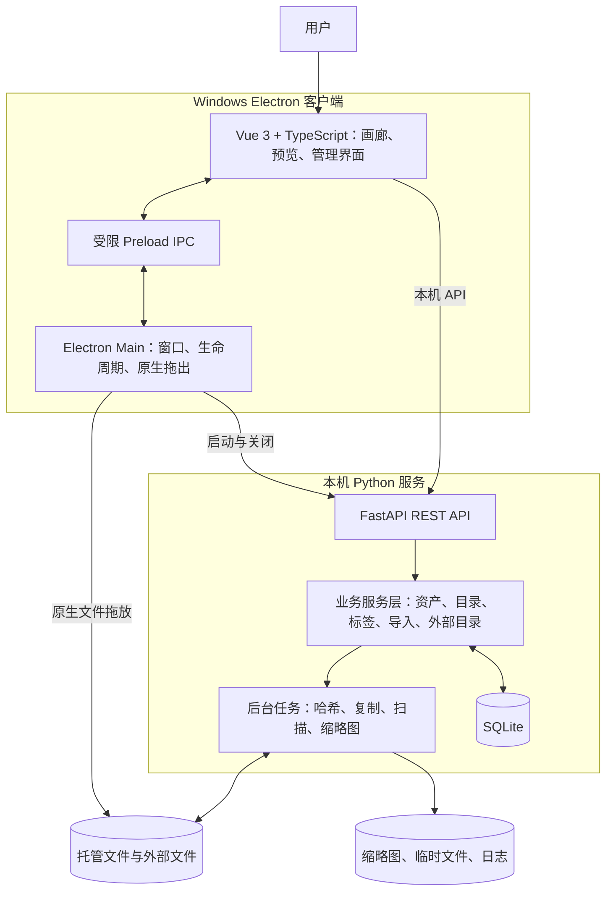

# Ryan_DAM 技术架构设计（V1）

- **版本**：v0.1
- **状态**：基于产品 Spec 的工程设计建议
- **产品基线**：[Ryan_DAM_Product_Spec_v1.md](./Ryan_DAM_Product_Spec_v1.md)

> 本文把已确认的产品决策转成可实施方案。工程建议不改变产品 Spec 已确认的范围。优先选择可维护、依赖少、适合单机应用的方案，不引入 Redis、Celery 或独立服务集群。

## 1. 架构目标

1. Windows 上以独立 Electron 客户端运行。
2. 使用 Vue 3 + TypeScript 构建资产管理界面。
3. 使用 Python FastAPI 处理元数据、文件操作、扫描、哈希、媒体信息和缩略图任务。
4. 使用 SQLite 保存元数据，不把大型媒体文件写进数据库。
5. 默认托管素材放在 `D:\Ryan_DAM\assets`；每个资产记录自己的实际文件路径。
6. 外部目录默认只读；转托管时复制文件并更新原资产记录，不创建重复资产记录。
7. 文件复制、哈希、媒体探测和缩略图生成不能阻塞 UI。
8. 第一版不依赖云服务、不做多用户、不做 AI 推理或自动更新。

## 2. 总体架构



### 2.1 Electron 主进程

负责操作系统集成，不承载资产业务规则：

- 创建窗口，首次约 1440 × 900 居中启动。
- 记录并恢复窗口尺寸、位置、最大化状态；恢复时检查屏幕可用区域。
- 启动和关闭随应用打包的 Python 后端。
- 提供文件/文件夹选择对话框。
- 处理 Electron 原生文件拖出。
- 处理应用退出、后端退出与异常启动提示。
- 通过最小化的 Preload API 暴露必要能力，不向 Renderer 开放 Node.js 全量权限。

建议安全设置：`contextIsolation: true`、`nodeIntegration: false`、启用内容安全策略；禁止渲染页面任意加载不可信远程内容。

### 2.2 Vue Renderer

使用 Vue 3、TypeScript、Vite、Tailwind CSS、shadcn-vue。

建议使用 Pinia 保存少量跨页面 UI 状态，例如当前目录、视图模式、选中资产和预览索引。服务端数据通过统一 API 客户端获取，分页和筛选参数显式管理。避免把整个资产库一次性载入前端内存。

Renderer 不直接使用 Node 文件系统 API；文件系统选择、窗口操作和原生拖出通过受限 IPC 交给 Main。

### 2.3 Python 后端

- FastAPI 提供本机 REST API。
- SQLAlchemy 管理 ORM 与事务。
- Alembic 管理数据库 schema 迁移。
- Pydantic 定义请求、响应与校验模型。
- 文件、目录、标签和资产操作集中在 Service 层，不把业务规则堆进路由函数。
- 使用简单的后台任务执行器，不引入 Redis/Celery。第一版可采用持久化任务记录 + 受控线程池/工作队列。
- 所有数据库连接按请求/任务独立创建与释放；启用 SQLite 外键约束与 WAL 模式。

## 3. 本地运行与进程生命周期

### 3.1 启动流程

1. Electron Main 读取窗口设置与应用数据目录。
2. 启动打包的 Python 后端进程，并传入数据库路径、日志目录和本次运行的本地访问令牌。
3. 后端绑定到 `127.0.0.1`，选定可用端口后输出就绪信息。
4. Electron 等待健康检查成功后，再加载 Vue 页面。
5. 前端通过统一 API 客户端访问本地服务。
6. 应用关闭时先通知后端停止接收新任务，再等待短暂的安全退出时间；无法正常退出时才终止子进程。

端口应动态选择或冲突后重试，不能假定固定端口永远可用。后端启动失败时显示可理解的错误和日志位置，不应无限白屏。

### 3.2 本机 API 安全

即使只供个人使用，本地 HTTP 服务也不能接受任意网页发起的危险操作。

- 只绑定 loopback 地址，不监听局域网网卡。
- 每次启动生成随机令牌；前端请求需要携带令牌。
- 校验请求来源与 Host/Origin；拒绝来自任意外部网站的跨站请求。
- Preload 暴露最小 API，不暴露通用 shell、任意文件读写或任意 IPC 通道。
- Markdown 预览按纯文本/安全渲染处理，禁止执行文档中的脚本或加载任意远程资源。
- 文件 API 只能访问数据库登记的资产路径，不接受任意文件路径作为普通请求参数。
- 日志中不记录令牌或敏感的完整内容。

## 4. 本地数据与文件存储

### 4.1 数据位置建议

- **默认托管素材根目录**：`D:\Ryan_DAM\assets`。
- **SQLite / 应用设置 / 日志**：使用 Windows 当前用户的应用数据目录，例如 `%LOCALAPPDATA%\Ryan_DAM\`。
- **缩略图缓存**：放在应用缓存目录，允许重建；不与数据库混为一体。
- **临时导入文件**：放在目标托管卷内的临时目录，以便完成后原子重命名，避免跨卷移动问题。
- 如果 D 盘或配置的目标盘不可用，不要静默切换到 C 盘；明确提示用户选择有效目录。

这意味着 C 盘只可能存放较小的数据库、日志和缓存，原始媒体默认存放在 D 盘。若用户选择其他资产根目录，仍按用户选择执行。

### 4.2 托管文件的物理布局

建议将 UI 里的逻辑文件夹和磁盘上的物理存储路径分开：

```text
D:\Ryan_DAM\assets\
  objects\<asset-id>\<original-filename>
  .staging\<job-id>\...
  .trash\<asset-id>\<original-filename>
```

- 每个托管资产都有稳定的 asset ID，并在数据库中保存实际 `file_path`。
- UI 中的通用资产/项目/子文件夹结构由数据库维护，不要求物理目录与 UI 目录一一对应。
- 该方式可以避免不同文件夹里同名文件冲突，也避免仅仅移动 UI 文件夹就需要搬动大量物理文件。
- 文件名在 UI 中保留用户可识别的原名；重命名单个托管资产时同步更新真实文件名与数据库路径。
- 从外部目录转托管时，复制到目标根目录下的新对象位置，校验成功后更新原记录的来源类型和 `file_path`。

V1 不要求 Windows 资源管理器中的物理目录与 UI 目录完全一致；用户日常通过 Ryan_DAM 中的逻辑目录管理素材。

### 4.3 文件操作安全顺序

**导入托管文件**

1. 预扫描文件数量和总大小，检查目标盘剩余空间。
2. 创建导入任务与任务明细。
3. 对文件计算哈希并检查完全重复项。
4. 将文件复制到目标卷的 staging 目录。
5. 校验文件大小，必要时再次核对哈希。
6. 原子移动到最终对象路径。
7. 在数据库事务中写入资产记录。
8. 生成缩略图和媒体元数据；失败时保留资产，只标记缩略图状态失败。

文件系统与 SQLite 不能形成真正的单一事务，因此需要补偿逻辑：若数据库写入失败，清理新建的孤立文件；若复制失败，清理未完成临时文件并将任务明细标记为失败。

**外部资产转托管**

1. 确认外部源文件仍可访问。
2. 在托管卷创建临时副本。
3. 校验副本大小和内容哈希。
4. 将副本原子移动到最终托管路径。
5. 更新原资产记录：`source_type=managed`、清空外部来源关联、更新实际路径。
6. 转换成功后外部源文件保持不变；资产库不新增第二条资产记录。
7. 若复制或校验失败，原记录仍保持 external 状态。

**删除到回收站**

- 只对托管资产执行文件移入回收站。
- 保存原始路径、原逻辑文件夹和删除时间，支持恢复。
- 永久删除才真正删除回收站中的文件。
- 外部资产移除只删除资产索引，不对源文件执行删除操作。

## 5. SQLite 数据模型

第一版以少量关系表覆盖已确认的功能，避免过早引入复杂抽象。

### 5.1 核心表

| 表 | 主要字段/职责 |
|---|---|
| `projects` | `id`、`name`、创建/更新时间 |
| `folders` | `id`、`name`、`scope_type`、`project_id`、`parent_id`、排序字段；用于通用资产和项目资产的逻辑目录树 |
| `assets` | `id`、`folder_id`、名称/扩展名/MIME、类型、大小、媒体属性、`file_path`、`source_type`、`external_source_id`、哈希、提示词、缩略图状态、创建/修改时间、删除状态 |
| `external_sources` | 外部根路径、目标逻辑文件夹、扫描时间、来源状态 |
| `tags` | 全局标签 ID、名称、颜色/创建时间（颜色为可选） |
| `asset_tags` | `asset_id` + `tag_id`，复合唯一约束 |
| `import_jobs` | 任务类型、状态、总数、成功/跳过/失败数、阶段、开始/结束时间 |
| `import_job_items` | 文件路径、状态、失败原因、关联资产 ID、重试次数 |
| `app_settings` | 默认托管根目录、窗口/界面偏好等必要设置 |

### 5.2 重要约束

- `assets.source_type` 使用受控值 `managed` / `external`。
- 外部资产需要有外部来源 ID；转托管成功后清空外部来源关联。
- 一个资产只有一条当前资产记录；外部转托管时更新该记录。
- 提示词字段允许为空，仅图片与视频资产在 UI 中显示提示词操作。
- 文件夹通过 `parent_id` 构建层级；项目目录不得跨项目移动。
- `asset_tags` 对同一资产和标签组合建立唯一约束。
- 对 `folder_id`、`source_type`、`external_source_id`、`sha256`、`name` 和 `deleted_at` 建立适当索引。
- 删除到回收站不立即删除数据库记录；恢复后清除删除状态并还原原逻辑目录。
- 文件路径以每个资产记录中的实际路径为准，不能只依赖当前默认托管根目录。

### 5.3 重复文件

- 使用 SHA-256 检测内容完全相同的文件。
- 哈希计算放到后台；大文件按块读取，不把整个文件载入内存。
- 默认重复项跳过，用户可以选择仍然导入。
- 不因哈希相同自动删除或合并已有资产。
- 同名但内容不同的目标冲突不覆盖原文件。建议自动添加递增后缀并在任务结果中说明；这是实现建议，不改变用户尚未明确的命名交互规则。

## 6. 后台任务与媒体处理

### 6.1 任务执行

第一版采用 SQLite 持久化任务记录 + 进程内受控 worker，不部署独立任务中间件。

- 文件复制/哈希与媒体缩略图工作设置合理的并发上限。
- 任务状态持久化，前端通过轮询任务 API 获取进度；V1 不需要 WebSocket。
- 程序关闭时将运行中的任务标记为 interrupted/failed，并保留可重试明细；不承诺断点续传。
- 任务重试只重跑失败明细，不重新处理已成功明细。
- 任务状态更新频率需节流，避免高频写 SQLite。

建议的任务状态：`queued`、`running`、`completed`、`completed_with_errors`、`failed`、`interrupted`。单文件状态：`pending`、`processing`、`success`、`skipped`、`failed`。

### 6.2 缩略图与媒体元数据

- 图片：生成尺寸受控的缓存缩略图，不直接把原图作为网格资源。
- 视频：使用 FFmpeg/ffprobe 提取时长、宽高和代表帧。
- 音频：优先读取内嵌封面与时长；无封面时使用默认音频卡片。
- 文档：根据扩展名使用图标；PDF/TXT/Markdown/JSON/CSV 走对应预览组件。
- 缩略图以 asset ID 为索引，并记录源文件大小/修改时间或哈希；源文件变化时重新生成。
- 缩略图失败不改变资产导入结果；在任务面板/资产状态中可诊断失败。
- FFmpeg/ffprobe 应作为可控的打包依赖处理，并在项目中记录所使用构建的许可信息；不要假定用户机器已安装。

### 6.3 性能原则

- 资产列表采用分页 API（建议每页约 50 项）与前端虚拟滚动/按需加载。
- 缩略图懒加载，设置并发上限。
- 列表 API 只返回卡片必要字段；完整元数据由详情 API 加载。
- 音视频预览端点需支持浏览器需要的 Range 请求/拖动进度条。
- 搜索第一版只覆盖文件名、标签、文件夹名/路径，不做文档全文检索或向量搜索。
- UI 操作即时反馈；非阻塞任务后台完成，失败时回滚或明确标记。

## 7. REST API 建议

统一前缀：`/api/v1`。路由职责建议如下：

| 方法 | 路径 | 职责 |
|---|---|---|
| GET | `/health` | 后端健康检查 |
| GET | `/assets` | 分页列表，支持文件夹、项目、类型、标签、大小、时间和关键词过滤 |
| GET | `/assets/{id}` | 资产详情 |
| PATCH | `/assets/{id}` | 更新允许编辑的元数据 |
| POST | `/assets/{id}/rename` | 重命名单个托管资产 |
| POST | `/assets/{id}/move` | 移动资产逻辑文件夹 |
| GET | `/assets/{id}/content` | 受控访问原始内容，支持音视频 Range |
| GET | `/assets/{id}/thumbnail` | 读取缓存缩略图 |
| PUT | `/assets/{id}/prompt` | 保存图片/视频完整提示词 |
| GET/POST | `/folders` | 查询/创建文件夹 |
| PATCH/DELETE | `/folders/{id}` | 重命名/删除文件夹 |
| GET/POST | `/projects` | 查询/创建项目 |
| GET/POST | `/tags` | 查询/创建全局标签 |
| POST | `/assets/bulk-tags` | 批量添加/移除标签 |
| POST | `/assets/bulk-move` | 批量移动 |
| POST | `/assets/bulk-trash` | 批量移入回收站 |
| GET/POST | `/imports` | 创建/查询导入任务 |
| GET | `/imports/{id}` | 查询任务进度与明细 |
| POST | `/imports/{id}/retry-failed` | 重试失败明细 |
| GET/POST | `/external-sources` | 查询/关联外部目录 |
| POST | `/external-sources/{id}/scan` | 手动重新扫描 |
| DELETE | `/external-sources/{id}` | 解除关联并清理仍为 external 的索引 |
| POST | `/assets/{id}/convert-to-managed` | 转托管，更新原记录 |
| GET | `/trash` | 查询回收站 |
| POST | `/trash/{id}/restore` | 恢复资产 |
| DELETE | `/trash/{id}` | 永久删除 |
| GET/PATCH | `/settings` | 读取/更新默认存储位置等设置 |

API 约定：
- 所有列表接口支持分页和稳定排序。
- 使用 Pydantic schema，不直接暴露 ORM 对象。
- 文件路径不由前端自由指定；前端只传 asset ID 和目标逻辑目录 ID。
- 错误响应包含稳定错误码、用户可理解消息与可诊断详情。
- 批量操作返回每项结果，不以一个文件失败掩盖其他项目结果。

## 8. 建议工程目录结构

```text
Ryan_DAM/
  apps/
    desktop/                 # Electron main、preload、窗口与打包配置
    web/                     # Vue 3 + TypeScript + Vite
  backend/
    app/
      api/v1/                # FastAPI 路由
      core/                  # 配置、日志、安全
      db/                    # SQLAlchemy、session
      models/                # ORM 模型
      schemas/               # Pydantic 请求/响应
      services/              # 资产、目录、导入、标签、外部目录
      workers/               # 哈希、扫描、缩略图
      main.py
    alembic/
    tests/
    requirements.txt
  docs/
  scripts/
  package.json
  README.md
```

目录可根据构建工具微调，不应为了形式而拆出大量小包。业务逻辑应集中在服务层，避免 Electron、Vue 和 FastAPI 各自实现一套文件规则。

## 9. 测试策略

必测安全路径：

1. 导入文件夹并保留 UI 目录层级。
2. 相同内容重复导入默认跳过，允许显式再次导入。
3. 复制中途失败时清理临时文件，不损坏已成功资产。
4. 转托管成功后只存在一条资产记录，原文件保留。
5. 解除外部目录关联只删除仍为 external 的索引，不删除原文件或托管资产。
6. 回收站恢复、永久删除、清空回收站。
7. 重命名/移动后数据库路径与实际文件一致。
8. 后端重启或异常退出后，任务状态可诊断。
9. 本机 API 不接受任意远程来源访问。
10. Electron 从资产卡片拖出真实文件，能拖到 Chrome 上传区域。

性能验收建议：
- 导入、哈希与缩略图生成时，主窗口仍可滚动、切换目录和打开已完成资产。
- 几千条资产列表不会一次性渲染全部 DOM。
- 缩略图生成失败不阻止资产浏览。
- 关闭预览后恢复之前的目录和滚动位置。
- 不能以牺牲数据安全换取 UI 动画或进度显示。

## 10. V1 工程取舍

**采用：**
- 一个 Electron 桌面应用 + 一个本地 FastAPI 进程。
- SQLite + SQLAlchemy/Alembic。
- 进程内 worker + SQLite 持久化任务。
- 每个资产保存实际路径；逻辑目录由数据库管理。
- FFmpeg/ffprobe 作为打包媒体工具。
- 基础 REST API、分页、缓存和可诊断任务状态。

**不采用：**
- Redis、Celery、Kafka、微服务。
- 云端存储、账户体系、多人协作。
- 向量数据库、AI 自动标签服务。
- 自动更新服务。
- 完整插件系统或通用工作流引擎。

## 11. 实现阶段需要验证的技术风险

1. **Electron 原生文件拖出**：最早验证 Windows 下可拖入 Chrome 上传区域，并验证是真实文件。
2. **Python 后端打包**：验证 PyInstaller 等方案可正确打包 FastAPI、媒体工具和依赖，避免依赖用户本机 Python。
3. **媒体预览兼容性**：解码能力受格式和编解码器影响；不支持格式提供系统默认应用打开的回退。
4. **外部目录扫描**：处理目录失效、文件重命名、变更和重复索引，不静默删除资产。
5. **数据库与文件一致性**：导入、转托管、回收站操作必须有失败补偿和可诊断日志。

这些风险通过小型 PoC 和测试验证，不需要在需求阶段继续展开讨论。
